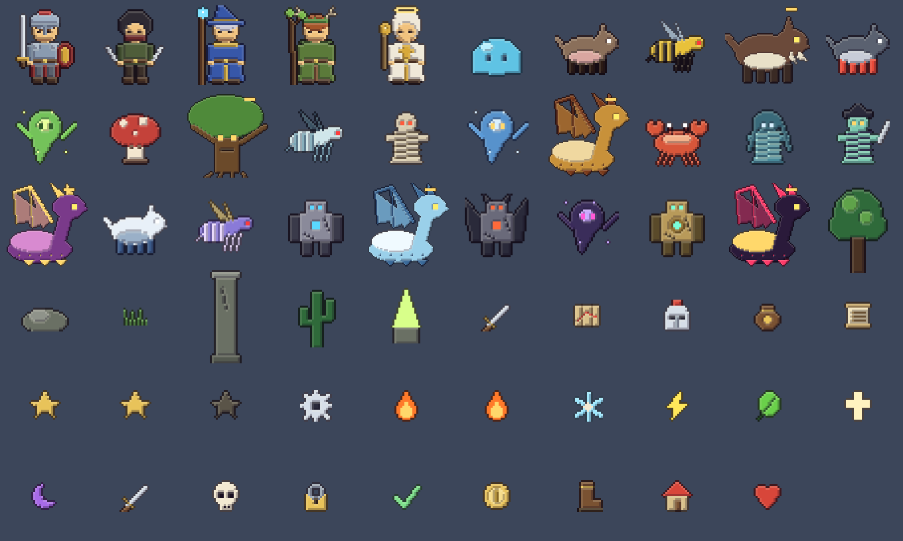

# StepQuest (native Android · Kotlin + Jetpack Compose)

An Android RPG powered by walking. **Every 1,000 real steps = 1 action in combat.** Lead a Warrior, Rogue, Mage, Druid and Priest through six regions in a layered, HD-2D-inspired pixel diorama. You earn coins and EXP for gear and skills, and trophies track how far you've walked, all the way to the Moon.

This branch (`android-kotlin`) is a native rewrite of the Unity version (branch `ccr-3052553b-8iivse`), so the APK can be built with nothing but the Android SDK.

**Download:** [`dist/StepQuest-0.1.0.apk`](dist/StepQuest-0.1.0.apk). It's signed with a debug key for sideloading. On your phone, allow "Install unknown apps" for your browser or file manager, open the APK, then grant **Physical activity** and **Notifications** when asked.



## Features

- **Steps → actions.** 1,000 steps make 1 banked action, and leftover steps carry over. Steps walked while the app is closed are caught up and credited to the right day. Reboots and Doze are handled, and a sanity cap of 250 steps/min filters out shaking.
- **Turn-based combat.** Turn order is by speed. Each hero command (Attack / Skill / Defend / Item / Flee) costs one action. When you run out, the battle pauses and saves, so you walk more and come back. You can tap enemies to attack them directly.
- **Break system.** Enemies have shields and hidden weaknesses ("?" until you hit them). Breaking an enemy's shield makes it lose a turn and take double damage.
- **Party.** Five classes, each with an 8-node skill tree; level cap 50.
- **Economy.** The shop gets new gear tiers as you reach new regions. There's an inn, consumables, boss drops and legendaries.
- **World map.** Six regions, unlocked by distance walked (15 → 500 km) plus beating the previous boss.
- **Trophies.** 46 in total: 1 km, marathon, Kármán line, ISS orbit, Great Wall, around the Earth and **% of the way to the Moon**. Others cover best days, "Everest in stairs", streaks and adventure milestones. A live comparisons panel adds facts like "12 km until you've crossed the English Channel".
- **Quests & streaks.** 3 daily and 2 weekly quests. Streaks multiply battle coins up to ×1.5, and one missed day per week is forgiven.
- **Notifications & widget.** You get "⚔ N new actions earned" notifications, rate-limited and silent at night. A home-screen widget shows today's steps, ready actions and progress to the next one.

**Pacing** is checked by simulation in `BalanceTest`:
- About 4–6 actions per normal fight.
- Bosses take 13–50 actions.
- About 5 months to finish at 8,000 steps/day.

## Layout

```
core/   Pure Kotlin game rules (no Android): steps, combat, party, items, world,
        achievements, quests, streaks, save, GameSession. JUnit tests + balance sims.
app/    Android app (Compose)
  steps/   Native step history from the hardware counter, WorkManager sampler,
           notifications, home-screen widget, boot receiver
  art/     Procedural pixel art (heroes, 24 monsters, props, icons) with outline + shading
  stage/   Diorama: banded sky, parallax silhouettes, perspective ground, tilt-shift blur,
           breathing sprites with contact shadows, torch glow, fireflies, vignette,
           animated attacks, hit sparks, damage numbers
  ui/      Screens: Town, Map, Battle, Party (gear, skill trees), Shop/Inn, Quests,
           Trophies, Settings
```

## Build

You need JDK 17+ and the Android SDK (platform 35, build-tools 35). Point `local.properties` at the SDK (`sdk.dir=/path/to/Android/Sdk`), then:

```bash
./gradlew :core:test            # game rules + balance/campaign simulations
./gradlew :app:assembleRelease  # → app/build/outputs/apk/release/app-release.apk
```

You can also open the folder in Android Studio and press Run.

To try it without walking, open **Settings → Developer → Show debug step buttons** to get +1k / +10k / +100k step buttons.

## Notes

- Step counting uses the phone's built-in hardware step counter, which keeps counting while the app is closed. Health Connect or smartwatch support would be a good addition.
- All art is generated in code, which keeps the APK at about 1 MB.
