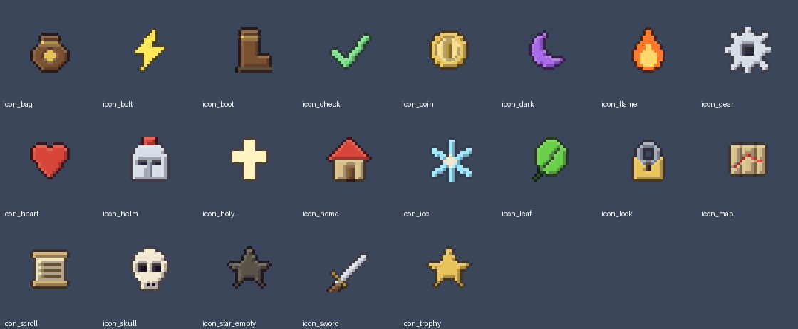

# StepQuest

An Android RPG powered by walking. **Every 1,000 real steps = 1 action in combat.** Lead a classic party of Warrior, Rogue, Mage, Druid and Priest through six regions in an HD-2D-inspired pixel-art diorama. You earn coins and EXP to buy better gear and learn skills, and trophies track how far you've walked, all the way to the Moon.


## What's in it

| System | Details |
|---|---|
| **Steps → actions** | 1,000 steps = 1 banked action, and leftover steps carry over. Steps walked while the app is closed are caught up on the next open and credited to the right day. Phone reboots and Doze are handled. |
| **Combat** | Manual turn-based play with turn order by SPD. Each hero command (Attack / Skill / Defend / Item / Flee) costs one action, and enemies act between your commands. When actions run out, the battle **pauses and is saved**, so you walk more and come back. |
| **Break system** | Enemies have shield points and hidden weaknesses. Hitting a weakness reveals it and chips the shield. At zero, the enemy is **broken**: it loses its next turn and takes double damage. |
| **Party** | Five classes with distinct stats and growth. Each class has an 8-node skill tree, and you earn skill points by levelling (cap 50). |
| **Economy** | Coins and EXP come from battles. The shop stocks new gear tiers as you reach new regions, and you can also buy consumables. The inn heals the party. Bosses drop unique gear, and the final boss drops legendaries. |
| **World map** | Six regions, from Greenmoor Meadow to Skyreach Ruins. Each opens once you've **walked far enough** (15 km … 500 km) and beaten the previous region's boss. |
| **Trophies** | 46 achievements: 1 km → marathon → Kármán line → ISS orbit → Great Wall → around the Earth → **% of the way to the Moon** (384,400 km). There are also daily-step records, "climbed Everest in stairs" trophies, streaks, and adventure milestones. A live **comparisons** panel shows lines like "You've walked 0.31% of the way to the Moon" and "12.3 km until you've crossed the English Channel". |
| **Quests & streaks** | 3 daily and 2 weekly quests, always including a step quest. A streak day means hitting your step goal. Streaks multiply battle coins (up to ×1.5), and one missed day per week is forgiven. |
| **Notifications & widget** | "⚔ 3 new actions earned" notifications are rate-limited and silent at night. A home-screen widget shows today's steps, ready actions and progress to the next one. |

### Pacing (checked by simulation)

`CoreTests/BalanceTests.cs` and `CampaignTests.cs` play thousands of simulated battles and a full campaign, so these numbers stay true as content changes:

* A normal fight takes **~4–6 actions** (4–6k steps) at the region's recommended level.
* Bosses take **12 → 50 actions**. Late bosses are a real threat (≈75–95% win rate at the recommended level).
* At **8,000 steps/day**, the full game takes **~5 months**, with levels tracking each region's recommendation.

## Project layout

```
StepQuest/                         Unity 6 project
  Assets/_Game/Core/               Pure C# game logic (no UnityEngine refs): steps, combat, party,
                                   items, world, achievements, quests, streaks, save, GameSession
  Assets/_Game/Unity/              Thin Unity layer
    Boot/      GameRoot (boots in any scene), save file I/O
    Steps/     AndroidStepBridge: C# side of the native step sampler
    Stage/     BattleStage: HD-2D diorama, SpriteActor billboards, StageFx (URP post stack)
    Art/       PixelArt: procedural sprites/icons (overridable), RegionPalette
    UI/        UI Toolkit screens built in code + Resources/UI/StepQuest.uss
  Assets/_Game/Editor/             One-click setup: URP, materials, scene, Android player settings
  Assets/Plugins/Android/StepBridge.androidlib/
                                   Java: reboot-safe step history, WorkManager sampler,
                                   notifications, home-screen widget
CoreTests/                         xUnit tests for the core (61 tests incl. balance + campaign sims)
```

All game rules live in `Core`, which compiles under C# 9 / .NET Standard 2.1. The test project uses the same language level, so anything that passes here also compiles in Unity.

## Getting started

1. Install **Unity 6 LTS (6000.0.x)** with **Android Build Support** (SDK, NDK and OpenJDK) from Unity Hub.
2. In Unity Hub, choose **Add → Add project from disk** and select the `StepQuest/` folder. On first open, Unity downloads packages (URP, Newtonsoft JSON). Then `ProjectSetup` runs automatically. It creates the URP pipeline asset, the sprite materials, the UI panel settings, `Assets/Scenes/Main.unity`, and Android player settings (`com.stepquest.game`, min SDK 28, target 35, IL2CPP, ARM64, portrait). You can re-run it from **StepQuest → Run Project Setup**.
3. **Press Play** to try it in the editor. Debug buttons (+1k / +10k steps) are on in the editor, on the Town screen and in Settings.
4. **Build for Android**: go to **File → Build Profiles → Android → Switch Platform**, then **Build** (or **Build And Run** with a phone connected over USB debugging).
5. On the phone, allow **Physical activity** and **Notifications** when prompted. To add the widget, long-press the home screen and choose **Widgets → StepQuest**.

### Running the tests (no Unity needed)

```bash
cd CoreTests
dotnet test                                   # 61 tests
dotnet test --filter "BalanceTests|CampaignTests" --logger "console;verbosity=detailed"   # see pacing numbers
```

## How step tracking works

Android's hardware **step counter** (`TYPE_STEP_COUNTER`) keeps counting in low-power hardware even when the app is closed. It reports a total since boot and resets on reboot. The native `StepBridge` turns that into a **reboot-safe history** of `(time, cumulative steps)` samples. It reads the counter:

* continuously while the game is open;
* every ~15 minutes in the background via WorkManager (which also refreshes the widget and posts notifications);
* right after boot, to re-baseline.

The game asks for "steps between A and B". Catch-up after the app was closed is split at local midnights, so daily totals, streaks and quests stay accurate. A sanity cap of 250 steps/minute filters out shaking. Syncs are idempotent, so nothing is counted twice.

> **Why not Health Connect?** Its API is Kotlin-coroutine only, so it needs a Kotlin Gradle setup that's fragile in Unity's Android build. The hardware counter has no dependencies, works offline, and is what Health Connect step data comes from on most phones anyway. Adding Health Connect as an optional extra source would be a good follow-up, e.g. to count steps from a smartwatch.

## Tuning the game

* `Core/Steps/StepLedger.cs`: `StepsPerAction` (1000) and `MaxStepsPerMinute`.
* `Core/Data/GameData.cs`: classes, skills, items, enemies, regions. The pacing knobs are `HpPacing`, `EnemyPowerPercent`, `BossPowerPercent` and `ExpScale`.
* `Core/Party/Leveling.cs`: the EXP curve.
* `Core/Meta/Achievements.cs`, `Quests.cs`, `Streaks.cs`: trophies, quests, streak rules.

After changing numbers, run the balance and campaign tests to see the effect on fight length, win rates and total campaign time.

## Art

The game ships with **procedurally generated pixel art**: heroes, monsters, bosses, props, backdrops and icons, all drawn in code with automatic outlining and shading. That way it runs out of the box. To use real art, drop PNGs into `Assets/Resources/Art/` with the matching names. See **[ART.md](ART.md)** for names, sizes and recommended CC0 sources.



## Troubleshooting

* **"Shader not found" / pink materials**: URP didn't install or wasn't assigned. Check that *Universal RP* appears in Package Manager, then run **StepQuest → Run Project Setup**. As a fallback, create a fresh project from Unity Hub's **Universal 3D** template and copy `Assets/_Game`, `Assets/Resources`, `Assets/Plugins` and `Packages/manifest.json` into it.
* **Gradle errors about AndroidX / WorkManager**: make sure **Project Settings → Player → Android → Publishing Settings** uses Unity's default Gradle templates. Unity 6 enables AndroidX by default.
* **No steps on the phone**: check that the Physical activity permission is granted (Settings screen in-game). Some emulators have no step sensor, so use a real device.

## Ideas for later

* Health Connect / smartwatch step source; GPS "expedition" mode.
* Cloud save (Google Play Games) and achievements sync.
* Friends: compare steps, gift actions, co-op raid bosses funded by everyone's steps.
* Seasonal events (e.g., double actions on weekends), more classes, job changes, crafting.
* Real pixel art, music and sound effects; haptics on hits and breaks.
